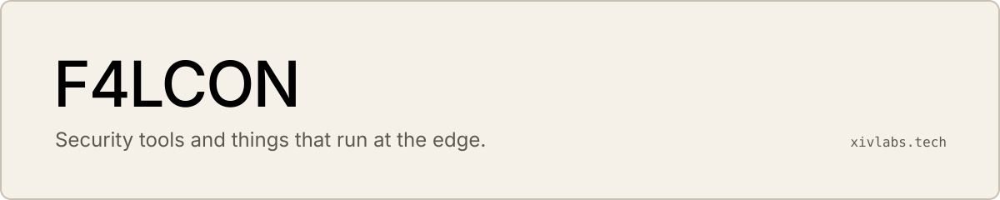

  
  
  

Live from <a href="https://github.com/itsF4LCON/hive">hive</a>, my honeypot. Every number above is someone trying to break in.

### About

Self-taught developer from Belgium studying cybersecurity, coding since I was 12.

### Stack

Rust · Python · Cloudflare Workers · D1 · WebRTC · Swift · JavaScript

### Contributions

<b>27 pull requests merged</b> into nushell, PhotoCraft and ruxen, all Rust · 14 more in review on PhotoCraft

| Project | PR | What it does |
|---|---|---|
| nushell | [#19205](https://github.com/nushell/nushell/pull/19205) | Clear error when the `from`/`to` converter of `open`/`save`/`http get` is an alias |
| ruxen | [#271](https://github.com/gvozdetsky/ruxen/pull/271) | One HTTP status reason table, matching nginx |
| PhotoCraft | [#4898](https://github.com/storytold/photocraft/pull/4898) | Layer locks: locking pixels clears the transparency lock |
| PhotoCraft | [#4880](https://github.com/storytold/photocraft/pull/4880) | Alerts: Enter is OK, but not the Enter that raised the alert |
| PhotoCraft | [#4870](https://github.com/storytold/photocraft/pull/4870) | Distort: a quad dragged past the horizon draws only its front side |
| PhotoCraft | [#4854](https://github.com/storytold/photocraft/pull/4854) | Navigator: one compact zoom row |
| PhotoCraft | [#4801](https://github.com/storytold/photocraft/pull/4801) | New Document: custom background colour |
| PhotoCraft | [#4730](https://github.com/storytold/photocraft/pull/4730) | Pen: a new path joins the selected path |
| PhotoCraft | [#4705](https://github.com/storytold/photocraft/pull/4705) | Load Files into Stack dialog |
| PhotoCraft | [#4687](https://github.com/storytold/photocraft/pull/4687) | Move tool: curved rotate cursor outside the transform box |
| PhotoCraft | [#4637](https://github.com/storytold/photocraft/pull/4637) | Align and Distribute with the Background layer selected |
| PhotoCraft | [#4612](https://github.com/storytold/photocraft/pull/4612) | Pen: close-path cursor over the first anchor |
| PhotoCraft | [#4607](https://github.com/storytold/photocraft/pull/4607) | Layers panel menus: highlight on press-drag |
| PhotoCraft | [#4578](https://github.com/storytold/photocraft/pull/4578) | Save for Web: no matte by default |
| PhotoCraft | [#4563](https://github.com/storytold/photocraft/pull/4563) | New Brush Preset dialog |
| PhotoCraft | [#4510](https://github.com/storytold/photocraft/pull/4510) | Shapes: test for the options bar Fill swatch |
| PhotoCraft | [#4479](https://github.com/storytold/photocraft/pull/4479) | Puppet Warp: undo and redo pin edits |
| PhotoCraft | [#4425](https://github.com/storytold/photocraft/pull/4425) | SVG: clipped groups open as editable shapes with a vector mask |
| PhotoCraft | [#4411](https://github.com/storytold/photocraft/pull/4411) | Recent files: saved documents are listed |
| PhotoCraft | [#4405](https://github.com/storytold/photocraft/pull/4405) | Save As: ICO, GIF and BMP |
| PhotoCraft | [#4399](https://github.com/storytold/photocraft/pull/4399) | Color panel: spectrum field in every theme |
| PhotoCraft | [#4390](https://github.com/storytold/photocraft/pull/4390) | Actions: record and play back Save a Copy |
| PhotoCraft | [#4371](https://github.com/storytold/photocraft/pull/4371) | Smart Filters: select and drag onto another smart object |
| PhotoCraft | [#3545](https://github.com/storytold/photocraft/pull/3545) | History panel snapshots |
| PhotoCraft | [#3465](https://github.com/storytold/photocraft/pull/3465) | Brush and Pencil: hold ~ to erase, Clear mode |
| PhotoCraft | [#2731](https://github.com/storytold/photocraft/pull/2731) | Home screen: remove single Recent entries (16 languages) |
| PhotoCraft | [#2448](https://github.com/storytold/photocraft/pull/2448) | OpenEXR/HDR export: linearize grayscale documents |

**In review**

| Project | PR | What it does |
|---|---|---|
| PhotoCraft | [#6387](https://github.com/storytold/photocraft/pull/6387) | Video Frames to Layers: every page of a multi-page TIFF |
| PhotoCraft | [#6386](https://github.com/storytold/photocraft/pull/6386) | Targa: RLE packets end with their scanline |
| PhotoCraft | [#6366](https://github.com/storytold/photocraft/pull/6366) | Type: the text caret shows on a white background |
| PhotoCraft | [#6351](https://github.com/storytold/photocraft/pull/6351) | Filters: the live preview at full resolution at 100 % |
| PhotoCraft | [#6346](https://github.com/storytold/photocraft/pull/6346) | File › Open: a file type filter per format |
| PhotoCraft | [#6344](https://github.com/storytold/photocraft/pull/6344) | Replace Color: a Result swatch that sets the sliders |
| PhotoCraft | [#6338](https://github.com/storytold/photocraft/pull/6338) | Smart Filters: an edited filter previews again |
| PhotoCraft | [#6335](https://github.com/storytold/photocraft/pull/6335) | Replace Color: the eyedropper is ready when it opens |
| PhotoCraft | [#6039](https://github.com/storytold/photocraft/pull/6039) | Window › Arrange: tiles keep their documents and get rulers |
| PhotoCraft | [#6038](https://github.com/storytold/photocraft/pull/6038) | Type: Korean paragraphs wrap between words |
| PhotoCraft | [#6035](https://github.com/storytold/photocraft/pull/6035) | Image Size: Indexed Color resamples with Nearest Neighbor |
| PhotoCraft | [#6030](https://github.com/storytold/photocraft/pull/6030) | Help › Search: typed letters go to the field |
| PhotoCraft | [#6026](https://github.com/storytold/photocraft/pull/6026) | Marquee: Fixed Size selects exactly the entered size |
| PhotoCraft | [#3567](https://github.com/storytold/photocraft/pull/3567) | History panel: New Snapshot dialog and the first snapshot |

### Now

Benchmarked <a href="https://github.com/itsF4LCON/swordfish">swordfish</a> against gitleaks (<a href="https://github.com/itsF4LCON/swordfish/tree/main/bench/accuracy">results</a>) · next: scoring its leak timelines · building Stoop, a recon toolkit in Rust · building Basilisk, a self hosted Minecraft server platform in Rust (agent, web panel, relay)

### Contact

Open to security internships and junior pentest roles · <a href="mailto:rangeerts@proton.me">email</a> · <a href="https://xivlabs.tech">xivlabs.tech</a>

